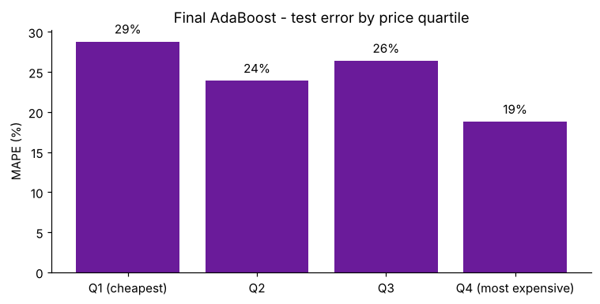
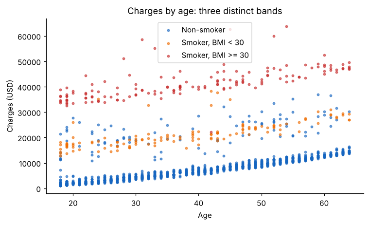
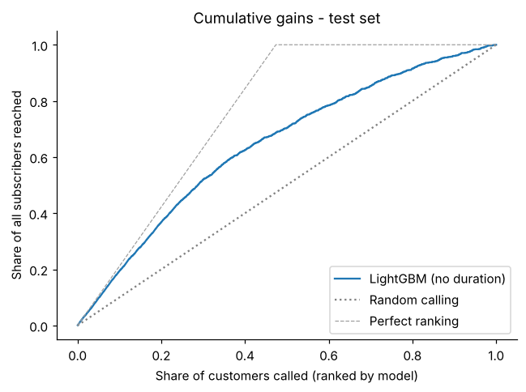

# Boosting in Practice: AdaBoost, XGBoost and LightGBM

Three boosting algorithms on three business problems. Each model is tuned, then checked against a simpler or more realistic alternative, because a tuned score means little until you know what it beats.

    

| Project | Task | Data | Primary metric | Headline |
|---|---|---|---|---|
| [AdaBoost: diamond prices](adaboost-diamond-prices/) | Regression | 53,772 diamonds | MAPE | Tuning cut MAPE from 42% to 24.5%, but a **single** depth-3 tree scored 23.2%. Base-tree depth, not the tuned grid, is the lever: gradient boosting on log-price reaches 7.0%. |
| [XGBoost: insurance charges](xgboost-insurance-charges/) | Regression | 1,337 policyholders | MAE (USD) | Tuning fixed severe overfitting (test MAE USD 2,846 to 2,108). A linear model with a smoker × obesity term matches XGBoost under repeated CV (USD 2,351 vs 2,488). |
| [LightGBM: bank marketing](lightgbm-bank-marketing/) | Classification | 11,162 customers | ROC-AUC | The grid selected the default settings (test AUC 0.922). Removing `duration`, which is only known after the call, gives a realistic AUC of 0.774 and still a 1.9x lift in the top decile. |

## Results

**AdaBoost: diamond prices (test set)**

| Model | MAPE | RMSE (USD) | R² |
|---|---|---|---|
| Baseline AdaBoost (defaults) | 42.2% | 1,391 | 0.875 |
| Tuned AdaBoost (lr 0.1, 50 trees, linear loss) | 24.5% | 1,346 | 0.883 |
| Single decision tree, depth 3 | 23.2% | 1,389 | 0.876 |
| AdaBoost with depth-10 trees | 10.5% | 622 | 0.975 |
| HistGradientBoosting on log-price | 7.0% | 559 | 0.980 |

**XGBoost: insurance charges**

| Model | Test MAE (USD) | Test R² | Repeated-CV MAE (USD) |
|---|---|---|---|
| Baseline XGBoost (defaults) | 2,846 | 0.850 | – |
| Tuned XGBoost (depth 3, lr 0.05, 200 trees) | 2,108 | 0.917 | 2,488 ± 151 |
| Linear regression + smoker × BMI terms | – | – | 2,351 ± 155 |

**LightGBM: bank marketing (test set)**

| Model | Accuracy | Precision | Recall | F1 | ROC-AUC |
|---|---|---|---|---|---|
| Baseline = tuned, with `duration` | 0.853 | 0.821 | 0.881 | 0.850 | 0.922 |
| Tuned, without `duration` | 0.724 | 0.765 | 0.601 | 0.673 | 0.774 |

<p align="center">
  
  
  
</p>

## How the three algorithms differ

| | AdaBoost | XGBoost | LightGBM |
|---|---|---|---|
| How each new tree is chosen | Re-weights samples: points with large errors get more weight | Fits the gradient of the loss, using second-order information | Same gradient approach, with histogram binning |
| Regularisation | Learning rate and number of rounds only | L1/L2 penalties on leaf weights, shrinkage, subsampling | Same as XGBoost, plus limits on leaves per tree |
| Tree growth | Usually shallow trees (default depth 3 for regression) | Level-wise (depth-limited) | Leaf-wise (best leaf first), so `num_leaves` matters most |
| Main weakness seen here | Weak base learners cap accuracy; sensitive to price scale | Overfits small data with default depth 6 | High scores can hide leaked features |

## Repository structure

```
boosting-adaboost-xgboost-lightgbm/
├── adaboost-diamond-prices/
│   ├── data/diamonds_dataset.csv
│   ├── starter/AdaBoost_Regressor_Exercise.ipynb        # original exercise template (unchanged)
│   ├── notebooks/adaboost_diamond_prices.ipynb          # completed, executed
│   └── outputs/{figures,metrics}/
├── xgboost-insurance-charges/        (same layout)
├── lightgbm-bank-marketing/          (same layout)
├── reports/Boosting_AdaBoost_XGBoost_LightGBM_Report.docx
├── requirements.txt
├── LICENSE
└── README.md
```

## How to run

```bash
git clone https://github.com/kashiprasadtn/boosting-adaboost-xgboost-lightgbm.git
cd boosting-adaboost-xgboost-lightgbm
python -m venv .venv && source .venv/bin/activate   # Windows: .venv\Scripts\activate
pip install -r requirements.txt
jupyter lab
```

Open any notebook in a project's `notebooks/` folder and run all cells. Approximate run times on 2 CPU cores: AdaBoost about 4 minutes, XGBoost under 1 minute, LightGBM about 1 minute. `random_state = 42` is used throughout.

## Data and attribution

- **Diamonds:** the classic *diamonds* dataset (ggplot2 / Kaggle), with columns renamed here because the raw file has two columns called `depth`.
- **Insurance:** *Medical Cost Personal Datasets* (Kaggle; from *Machine Learning with R*, B. Lantz).
- **Bank marketing:** a balanced 11,162-row sample of the UCI *Bank Marketing* dataset (Moro, Cortez & Rita, 2014).
- All three were supplied through upGrad coursework and are included for educational, non-commercial use; see each original source for its terms.
- **Starter notebooks** in each `starter/` folder are upGrad course material, kept unchanged for reference. The completed notebooks and all extensions are my own implementation.
- Coursework completed during my MS in Artificial Intelligence (Liverpool John Moores University, delivered via upGrad); published to GitHub in November 2026.

## Licence

Code is released under the [MIT License](LICENSE). Datasets and starter notebooks are excluded (see above).
